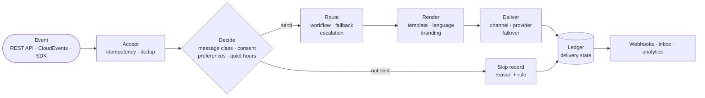
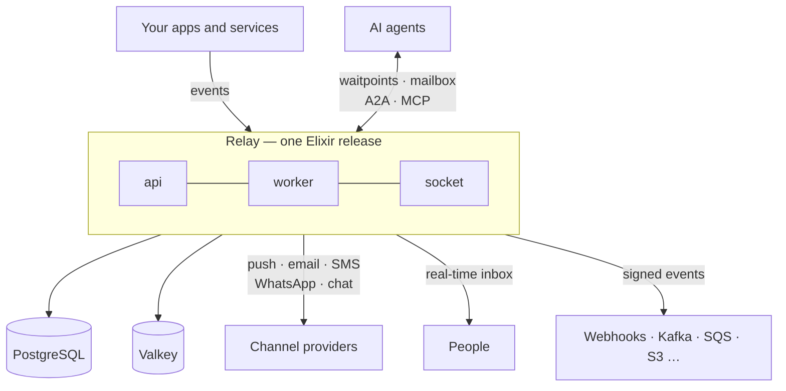

# Relay

**Open-source notification, messaging and event delivery — for people, services, devices and AI agents.**

Relay takes an event from your product and gets it to the right recipient, on the right channel, at the right time — with consent rules applied, retries and fallback handled, and a record of what happened. When a message is *not* sent, Relay tells you why.

[](LICENSE)


---

## Why Relay

Every product ends up rebuilding the same notification plumbing: channel selection, retries, provider failover, preference centers, quiet hours, consent registries, delivery tracking, in-app inboxes and webhooks. And AI agents add a new need: asking a human a question, waiting for the answer, and escalating when nobody responds.

Relay does all of that in one place, on infrastructure you already know: **PostgreSQL and Valkey**. Nothing else is required.

## Features

**Channels**
- Push (APNs, FCM, Web Push, HMS), email (ESPs or your own SMTP server), SMS, voice
- WhatsApp, Slack, Microsoft Teams, Telegram
- In-app inbox with real-time updates (WebSocket and SSE)
- Webhooks and event destinations: HTTPS, Kafka, NATS, RabbitMQ, SQS, SNS, EventBridge, Pub/Sub, Service Bus, S3

**Orchestration**
- Workflows built in a visual editor, as YAML/JSON files in git, or with an SDK — all the same format
- Routing policies with fallback, fan-out and last-active device; escalate-unless-seen
- Digest, throttle, deduplication, scheduling, recurring notifications, A/B tests
- Topics and subscriptions; multi-tenant with sub-tenants (per-customer branding and senders)

**Reliability**
- Idempotent API, at-least-once delivery with deduplication
- Provider error classification, circuit breakers, active-passive or cost-based provider routing
- Four-axis delivery state from an append-only ledger; honest `unknown` when a provider stays silent
- Kill switch, per-tenant fairness, priority lanes that keep OTP traffic moving

**Consent and compliance**
- Message classes (security, transactional, marketing, …) that drive the rules
- Preference center: category × channel, per-workflow opt-out, mute, quiet hours
- Turkey's İYS consent registry built in; one-click unsubscribe (RFC 8058); per-country rules for TR, EU and US
- No physical deletes; personal data erasure by crypto-shredding

**For AI agents**
- Waitpoints: ask a human or a system, wait durably, never lose an early reply
- Durable agent mailboxes with lease/ack; built-in escalation chains
- A2A, MCP and AG-UI support
- Messages to agents are structured data, never instructions; replies are never treated as authorization

## How it works





One Elixir application, one release. Run it as a single process, or scale the `api`, `worker` and `socket` roles separately. PostgreSQL holds every source of truth; Valkey carries signals and counters.

## Getting started

Relay is under active development; the project foundation is in place and the product features are being built. You need Docker, [`just`](https://github.com/casey/just), the Erlang/Elixir versions in `.tool-versions` (install them with [`mise`](https://mise.jdx.dev)), a Rust toolchain, SoftHSM and OpenSC (`brew install softhsm opensc`, `apt install softhsm2 opensc`).

```sh
git clone https://github.com/e-suiss/relay.git
cd relay
just dev     # local services, a SoftHSM key store with its keys, then the node itself
just test    # the test suite against the real database
just check   # every check CI runs on a pull request
```

Local services: Mailpit on <http://localhost:8025>, Jaeger on <http://localhost:16686>, Prometheus on <http://localhost:9090> and Grafana on <http://localhost:3000>.

SDKs are planned for TypeScript/Node, Python, Go, Java, .NET, Elixir, PHP and Ruby, plus iOS, Android, React Native and Flutter, with ready-made inbox, toast and preference components (React and web components).

## Command line

The `relay` command line tool talks to the Relay API with an Access API client. Build it with `mix escript.build`; the executable is written to `_build/escript/relay` and needs only Erlang/OTP to run.

```sh
export RELAY_API_URL=https://relay.example.com
export RELAY_ACCESS_ISSUER=https://access.example.com
export RELAY_ENVIRONMENT=test            # test or live: the environment of the API client
export RELAY_CLIENT_ID=cli_...
export RELAY_CLIENT_SECRET_FILE=~/.config/relay/test.secret

relay trigger welcome --to user-4821 --data '{"first_name": "Ayşe"}'
relay preview welcome --to user-4821 --data-file data.json   # dry run, test only
relay logs --follow                                          # watch new notifications
relay listen --forward-to http://localhost:3000/relay        # forward them to your app
relay pull && relay push --publish                           # workflows as files
relay promote welcome --yes                                  # test version to live
relay kill-switch engage --scope workflow --ref welcome --reason "bad copy" --ttl PT1H
```

Every command accepts `--json` and then prints one JSON object with an `exit_code` field. Exit codes are stable: `0` success, `1` unexpected error, `2` usage error, `3` authentication or authorization, `4` not found, `5` validation or conflict, `6` rate limit or quota, `7` server or connection, `8` live change not confirmed. A command that changes the live environment asks for confirmation, or takes `--yes`. Run `relay help` for every option, including profiles in `~/.config/relay/config.json`.

## Tech stack

Elixir/OTP, Phoenix, PostgreSQL, Valkey, Oban (open source), React for the console and UI components.

## Related projects

- **[Access](https://github.com/e-suiss/access)** — identity and authority. Relay and Access are parts of one system and are always deployed together: Access sends its messages through Relay, and Relay uses Access for sign-in and approvals.

## Contributing

Contributions are welcome. Read [CONTRIBUTING.md](CONTRIBUTING.md) before opening a pull request, and report vulnerabilities privately as described in [SECURITY.md](SECURITY.md).

## License

Relay is open source under the [Apache License 2.0](LICENSE). Self-hosted and Suiss-hosted Relay run the same code; no feature is cloud-only.
