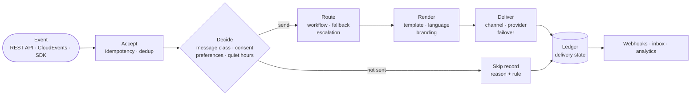
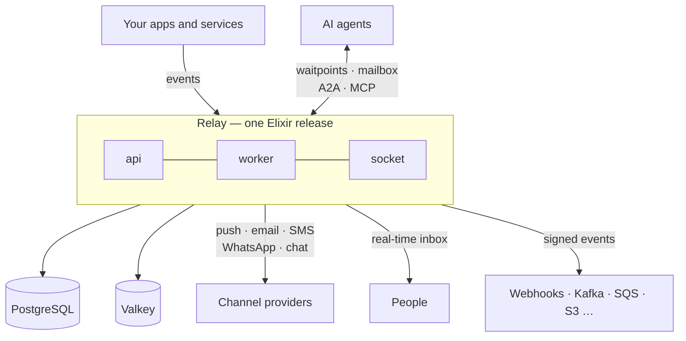

# Relay

**Open-source notification, messaging and event delivery — for people, services, devices and AI agents.**

Relay takes an event from your product and gets it to the right recipient, on the right channel, at the right time — with consent rules applied, retries and fallback handled, and a record of what happened. When a message is *not* sent, Relay tells you why.

[](LICENSE)


---

## Why Relay

Every product ends up rebuilding the same notification plumbing: channel selection, retries, provider failover, preference centers, quiet hours, consent registries, delivery tracking, in-app inboxes and webhooks. And AI agents add a new need: asking a human a question, waiting for the answer, and escalating when nobody responds.

Relay does all of that in one place, on infrastructure you already know: **PostgreSQL and Valkey**. Nothing else is required.

## Features

**Channels**
- Push (APNs, FCM, Web Push, HMS), email (ESPs or your own SMTP server), SMS, voice
- WhatsApp, Slack, Microsoft Teams, Telegram
- In-app inbox with real-time updates (WebSocket and SSE)
- Webhooks and event destinations: HTTPS, Kafka, NATS, RabbitMQ, SQS, SNS, EventBridge, Pub/Sub, Service Bus, S3

**Orchestration**
- Workflows built in a visual editor, as YAML/JSON files in git, or with an SDK — all the same format
- Routing policies with fallback, fan-out and last-active device; escalate-unless-seen
- Digest, throttle, deduplication, scheduling, recurring notifications, A/B tests
- Topics and subscriptions; multi-tenant with sub-tenants (per-customer branding and senders)

**Reliability**
- Idempotent API, at-least-once delivery with deduplication
- Provider error classification, circuit breakers, active-passive or cost-based provider routing
- Four-axis delivery state from an append-only ledger; honest `unknown` when a provider stays silent
- Kill switch, per-tenant fairness, priority lanes that keep OTP traffic moving

**Consent and compliance**
- Message classes (security, transactional, marketing, …) that drive the rules
- Preference center: category × channel, per-workflow opt-out, mute, quiet hours
- Turkey's İYS consent registry built in; one-click unsubscribe (RFC 8058); per-country rules for TR, EU and US
- No physical deletes; personal data erasure by crypto-shredding

**For AI agents**
- Waitpoints: ask a human or a system, wait durably, never lose an early reply
- Durable agent mailboxes with lease/ack; built-in escalation chains
- A2A, MCP and AG-UI support
- Messages to agents are structured data, never instructions; replies are never treated as authorization

## How it works





One Elixir application, one release. Run it as a single process, or scale the `api`, `worker` and `socket` roles separately. PostgreSQL holds every source of truth; Valkey carries signals and counters.

## Getting started

Relay is under active development; the project foundation is in place and the product features are being built. You need Docker, [`just`](https://github.com/casey/just), the Erlang/Elixir versions in `.tool-versions` (install them with [`mise`](https://mise.jdx.dev)), a Rust toolchain, SoftHSM and OpenSC (`brew install softhsm opensc`, `apt install softhsm2 opensc`).

```sh
git clone https://github.com/e-suiss/relay.git
cd relay
just dev     # local services, a SoftHSM key store with its keys, then the node itself
just test    # the test suite against the real database
just check   # every check CI runs on a pull request
```

`just dev` seeds a sample tenant with a recipient, a published `welcome` workflow and a test API client, linked to a local stand-in for Access. Send a first event:

```sh
TOKEN=$(mix relay.dev.token)
curl -X POST http://localhost:4000/v1/events \
  -H "Authorization: DPoP $TOKEN" \
  -H "DPoP: $(mix relay.dev.proof POST http://localhost:4000/v1/events "$TOKEN")" \
  -H "Idempotency-Key: $(uuidgen)" \
  -H "Content-Type: application/json" \
  -d '{"workflow": "welcome", "to": ["dev-sample-recipient"], "data": {"first_name": "Ayşe"}}'
```

Local services: Mailpit on <http://localhost:8025>, Jaeger on <http://localhost:16686>, Prometheus on <http://localhost:9090> and Grafana on <http://localhost:3000>.

SDKs are planned for TypeScript/Node, Python, Go, Java, .NET, Elixir, PHP and Ruby, plus iOS, Android, React Native and Flutter, with ready-made inbox, toast and preference components (React and web components).

## Command line

The `relay` command line tool talks to the Relay API with an Access API client. Build it with `mix escript.build`; the executable is written to `_build/escript/relay` and needs only Erlang/OTP to run.

```sh
export RELAY_API_URL=https://relay.example.com
export RELAY_ACCESS_ISSUER=https://access.example.com
export RELAY_ENVIRONMENT=test            # test or live: the environment of the API client
export RELAY_CLIENT_ID=cli_...
export RELAY_CLIENT_SECRET_FILE=~/.config/relay/test.secret

relay trigger welcome --to user-4821 --data '{"first_name": "Ayşe"}'
relay preview welcome --to user-4821 --data-file data.json   # dry run, test only
relay logs --follow                                          # watch new notifications
relay listen --forward-to http://localhost:3000/relay        # forward them to your app
relay pull && relay push --publish                           # workflows as files
relay promote welcome --yes                                  # test version to live
relay kill-switch engage --scope workflow --ref welcome --reason "bad copy" --ttl PT1H
```

Every command accepts `--json` and then prints one JSON object with an `exit_code` field. Exit codes are stable: `0` success, `1` unexpected error, `2` usage error, `3` authentication or authorization, `4` not found, `5` validation or conflict, `6` rate limit or quota, `7` server or connection, `8` live change not confirmed. A command that changes the live environment asks for confirmation, or takes `--yes`. Run `relay help` for every option, including profiles in `~/.config/relay/config.json`.

## Discovery

A client needs only its Access issuer. The Access Suiss discovery document (`<access issuer>/.well-known/suiss-configuration`) names the Relay installation in `suiss_relay`, and Relay's own discovery document is at `<suiss_relay>/.well-known/relay-configuration`. Its `issuer` is byte for byte the `suiss_relay` value (no trailing slash) and is the `source` of every event Relay sends.

The document carries the API base, the data region, the bound Access issuer, the supported dated contract versions, the address of the product event key set (`jwks_uri`) and the capabilities served by this installation as `urn:suiss:relay:<capability>:<version>` URNs, each with its endpoint. A capability is listed only while all of its operations are served. Both documents are public and may be cached for five minutes.

## Authentication

Relay has no API keys of its own. A backend calls the server API with a short-lived Access access token of an API client registered in Access, obtained with the OAuth 2.0 client credentials grant and `resource` set to Relay's Access `client_id` (`access_client_id` in Relay's discovery document). The token is sender-constrained with DPoP (RFC 9449): every request carries it as `Authorization: DPoP <token>` together with a `DPoP` header holding a fresh proof signed by the token's key, naming the request's method and URL and the token's hash. A proof is accepted once; there is no bearer token.

The token only says who is calling. The tenant, the environment (`test` or `live`), an optional subtenant and the scopes come from Relay's record of the API client. Enterprise tenants can additionally bind tokens to a client certificate (RFC 8705).

Apps never send Access tokens to the inbox, preference or realtime endpoints. They exchange the signed-in user's DPoP-bound Access token, with a proof, for a short-lived Relay subscriber token at `POST /v1/subscriber/token` (RFC 8693) and use that as a Bearer token.

## Channels without provider accounts

A self-hosted Relay sends on three channels without any third-party account:

- **Email over your own SMTP server.** The generic SMTP adapter talks to any mail server you run (Postfix, Exim, a relay host) with your own DKIM key.
- **Web Push with VAPID.** Relay signs with a VAPID key pair from its own key store; browsers subscribe with the public key and Relay encrypts each message (RFC 8291) and posts it to the browser vendor's push service. No vendor account is needed.
- **In-app inbox.** Real-time over WebSocket or SSE from Relay itself.

Every other channel runs on the tenant's own credentials: APNs, FCM and HMS push, email service providers, SMS and voice operators, WhatsApp Cloud API, Slack, Microsoft Teams, Telegram and Discord. A provider account takes traffic only once it is verified, and credentials are write-only: they live in the secret backend and are never returned by the API.

There is no push path to iOS devices other than Apple's APNs. An iOS app always needs an APNs key or certificate from the app's Apple developer account; a deployment that must keep all data in one country can still use Web Push, in-app and its own SMTP server, but iOS push notifications always pass through Apple.

To try a channel without sending anything, use the test environment: every address in the simulated ranges (`<result>@sim.relay.test`, `+9905550000NN`, `sim:<result>`) produces a fixed result, and `GET /v1/test/simulated-results` lists them. The live environment refuses these addresses.

## Ingest connectors

Besides the HTTP API (native JSON events and CloudEvents on `POST /v1/events`), Relay can take events from a producer's own database. The built-in source is a **PostgreSQL outbox table**: your service writes one structured mode CloudEvent per row in the same transaction as its own change, and Relay relays the rows and records the outcome of each one. Relay never deletes a row. The table shape is a contract, [`contracts/connectors/outbox.sql`](contracts/connectors/outbox.sql); Relay checks it when it connects and does not read a table that differs.

A production node reads its connectors from the JSON file that `RELAY_CONNECTORS_FILE` names; without the variable no connector runs. The file is checked strictly at boot and a node with an invalid file does not start. Database passwords never go in the file: each connector names a `password_file`, read at every connect.

```json
{
  "connectors": [
    {
      "name": "orders",
      "source": "outbox",
      "access_tenant_id": "acc_...",
      "access_client_id": "app_...",
      "options": {
        "hostname": "db.example.com",
        "database": "shop",
        "username": "relay_reader",
        "password_file": "/run/secrets/shop_db",
        "table": "public.relay_outbox",
        "ssl": true
      }
    }
  ]
}
```

Kafka and SQS sources are not part of the Relay release. The recommended path for those is to forward events to Relay as CloudEvents over HTTP, or to write them to an outbox table. An installation that needs a direct Kafka or SQS source builds its own release with the `broadway_kafka` or `broadway_sqs` package; Relay carries only the adapter.

## Tech stack

Elixir/OTP, Phoenix, PostgreSQL, Valkey, Oban (open source), React for the console and UI components.

## Related projects

- **[Access](https://github.com/e-suiss/access)** — identity and authority. Relay and Access are parts of one system and are always deployed together: Access sends its messages through Relay, and Relay uses Access for sign-in and approvals.

## Contributing

Contributions are welcome. Read [CONTRIBUTING.md](CONTRIBUTING.md) before opening a pull request, and report vulnerabilities privately as described in [SECURITY.md](SECURITY.md).

## License

Relay is open source under the [Apache License 2.0](LICENSE). Self-hosted and Suiss-hosted Relay run the same code; no feature is cloud-only.
